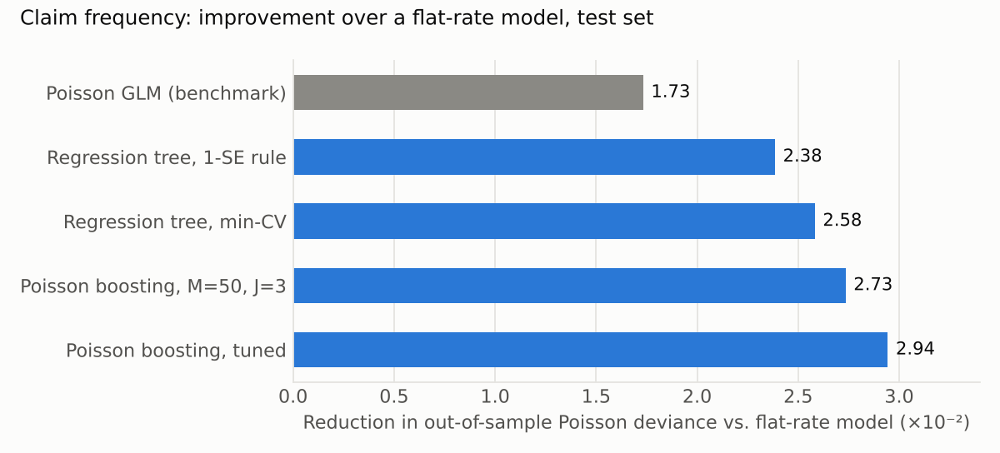

# Motor Insurance Claim Frequency Modelling

Claim frequency models for 678,013 French motor third-party liability policies (freMTPL2freq: 36,102 claims, 358,499 years of exposure, 95% of policies claim-free). Claim counts are modelled as Poisson with the policy exposure as offset, and models are compared by average Poisson deviance on a 10% test set (610,212 learning / 67,801 test policies).

## What was done

1. **Benchmarks.** A flat-rate (intercept-only) model and a 49-parameter Poisson GLM with banded driver age, vehicle age and vehicle power, capped bonus-malus, log density and categorical brand and region.
2. **Regression tree** (course assignment, Q1). A large Poisson tree (relative cost-complexity 0.00005, at least 1,500 policies per leaf), pruned by 10-fold cross-validation; both the minimum-CV tree and the 1-SE tree are reported.
3. **Poisson boosting machine** (course assignment, Q2). Implemented from scratch: each depth-3 tree is fitted to the current expected claim counts, which are then updated multiplicatively; 50 trees, at least 10,000 policies per leaf, no shrinkage.
4. **Tuned boosting.** Shrinkage, tree depth and leaf size chosen on a validation split carved out of the learning data, with early stopping; the test set is never used for tuning.
5. **Checks.** Split-gain variable importance and a paired bootstrap (2,000 resamples of the test policies) for every gap between the tuned model and the others.

## Results

Average Poisson deviance, in units of 10⁻² (lower is better):

| Model | In sample | Out of sample | vs. GLM |
|---|---|---|---|
| Flat rate | 33.12 | 32.97 | +5.5% |
| Poisson GLM | 31.47 | 31.23 | – |
| Regression tree, 1-SE rule (21 leaves) | 30.86 | 30.58 | −2.1% |
| Regression tree, min-CV (102 leaves) | 30.54 | 30.39 | −2.7% |
| Poisson boosting, 50 trees, depth 3 | 30.37 | 30.23 | −3.2% |
| Poisson boosting, tuned (244 trees, depth 5, shrinkage 0.1) | 29.92 | **30.02** | **−3.9%** |

- Relative to the flat rate, tuned boosting removes 2.94 units of deviance against 1.73 for the GLM, 1.7 times the GLM's improvement.
- Bootstrap 95% interval for tuned boosting minus GLM: −1.38 to −1.04, so the gap is not sampling noise.
- Vehicle age (31.6%) and bonus-malus level (31.3%) account for most of the split gain, followed by vehicle brand (9.6%) and driver age (8.0%).



## Reproduce the results

From the repository root, install the Python dependencies and follow the [dataset instructions](DATA.md) to place `freMTPL2freq.rda` in the repository root. Then run

```bash
python -m pip install -r requirements.txt
python claim_frequency.py freMTPL2freq.rda .
python plot_claim_gain.py
```

The plot can also be regenerated from the included results without refitting the models.
To run the original R analyses, use the repository root as the working directory. The scripts use the R packages `rpart`, `rpart.plot`, `plotrix`, and `Hmisc`.

## Files

- `claim_frequency.py`: the full pipeline (data loading, all models, cross-validation, tuning, bootstrap).
- `claim_frequency_results.json`: every number above, plus the CV curve, the tuning grid and the boosting loss paths.
- `DATA.md`: how to download `freMTPL2freq.rda`.

## Notes

- Trees use scikit-learn's Poisson criterion with exposure weights. Categorical levels are ordered by observed claim frequency before splitting, which is what rpart does for unordered factors in Poisson trees.
- The original R submission (`assignment2_*.R`) uses rpart and R's random split, so its numbers differ slightly (out-of-sample 30.24 for the tree and 30.19 for boosting); the ranking of models is the same.
